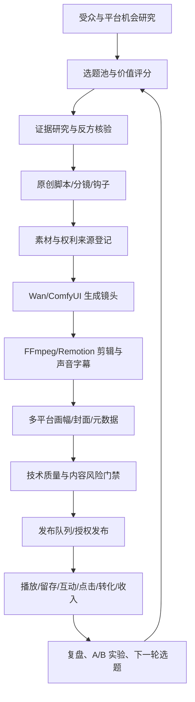

# Muse 高价值视频工厂：端到端生产、分发与收益反馈

日期：2026-11-13
状态：产品目标与实施规范；并非全部能力已交付。

## 1. 目标

把 Muse 从“能生成/合成视频的本地工具”升级为“研究驱动的内容产品工厂”：自动发现值得回答的问题，形成有来源的原创内容，生产多平台版本，检查质量与权利风险，准备发布，并把真实平台表现与收入数据回流到研究和进化账本。

核心目标不是制造低质数量，而是持续生产对明确受众有用、原创、可验证、能建立信任的内容。任何流量、粉丝增长、平台分成、广告收入或商业转化都不作保证；系统只能优化可控的内容质量、发布节奏和实验方法。

## 2. 端到端闭环

每个阶段必须写入同一个 Creator Initiative / Research Wiki / Evolution 账本，保存来源、脚本版本、素材哈希、模型参数、成片哈希、发布状态、指标来源和实验结论。

## 3. 高价值选题评分

选题不是简单追热点。为每个候选记录 0-5 分及理由：
- 受众痛点/需求强度（25%）
- 证据质量与可核验性（20%）
- 原创角度/差异化（20%）
- 可视化与叙事潜力（15%）
- 长期搜索/复用价值（10%）
- 生产成本与可持续性（10%）

扣分/否决项：来源无法核实、抄袭或搬运、版权不清、危险误导、虚假收益承诺、纯粹重复低质内容。评分是排序辅助，不是流量预测。

## 4. 内容研究与创作规范

- 先定义目标观众、他们的问题、观看后能做什么，再确定题目。
- 主张拆分为可核验事实、解释、个人经验、观点、假设与虚构表达。
- 保留原始出处、发布时间、引用位置、支持证据、反面证据、来源独立性和置信度。
- 至少主动寻找反证或替代解释；没有可靠来源就明确说未证实。
- 脚本结构可采用：前 1-3 秒提出具体问题 → 承诺明确价值 → 证据/步骤/演示 → 结论与行动提示。
- 不伪造专家身份、用户评价、新闻画面、数据、案例、品牌背书或亲身经历。
- AI 生成内容、合成声音、虚构场景及商业合作按对应平台的现行规则披露。

## 5. 素材、版权与来源链

每项图片、视频、音乐、字体、配音、商标和第三方素材记录：
- 来源 URL/本地路径、作者/权利人、取得时间、许可/授权依据、允许用途、署名要求、到期/撤回条件。
- 文件 SHA-256、派生关系、是否 AI 生成、模型与提示词版本。
- 无法确认商用许可的素材不得进入商业发布包；默认优先原创生成、用户自有素材和明确可商用素材。
- 音乐/字体/肖像/商标等风险须单独检查；“网上能下载”不等于可商用。

## 6. 生产管线

### 6.1 选题到镜头
生成可编辑脚本、分镜、逐镜提示词、镜头时长、旁白稿、字幕稿、B-roll 需求、封面方向和 CTA。镜头逐个生成，记录 ComfyUI prompt_id、模型、seed、时长、分辨率和失败重试。

### 6.2 本地渲染
优先复用本机 ComfyUI + Wan 2.1、FFmpeg、AMD AMF；必要时 CPU fallback。当前 Wan 2.1 1.3B 接口受限于 512 级预览、单次 1-5 秒、12 FPS；长片必须多镜头生成后编辑，不能把单镜头原型宣传为高分辨率电影级生成。Remotion 可用于图形/字幕/数据动画，但须先核验现有项目适配器。

### 6.3 平台输出
以一个高质量母版为源，按目标平台的实时规范生成独立版本：竖屏短视频、方形/横屏内容、封面、字幕文件、标题、简介、标签、章节、置顶评论草稿和来源说明。规格必须版本化，不可假设各平台限制永久不变。

### 6.4 技术质检
自动验证：
- 容器可解码、视频/音频流存在、编码/尺寸/帧率/时长符合所选平台配置。
- 黑帧/静帧、意外空白、音频峰值/响度/静音、字幕时间轴/越界/错字抽检。
- 字幕与旁白一致性；封面尺寸与文件完整性。
- ZIP CRC、manifest、所有产物 SHA-256 与源素材追溯。
- 每个平台的格式门禁独立通过，不能用一个平台通过代替全部平台通过。

### 6.5 内容与发布门禁
对事实准确性、来源、版权、肖像、隐私、广告披露、AI 合成披露、音乐授权、平台社区规则、未成年人和高风险领域进行检查。高风险/不确定项目转人工审核。发布前可设置人工总闸；自动发布仅能使用官方授权 API/OAuth、最小权限、可撤销 Token 和明确的账号/频道白名单，不保存密码、不模拟绕过平台风控。

## 7. 多平台发布与收益回流

目标平台可分批接入：YouTube Shorts、TikTok、Instagram Reels、Facebook Reels、Bilibili、抖音等。每个平台单独实现：
- 官方 API 可用性、地区/账号资格、上传限制、审核状态、配额、OAuth scope 和政策检查。
- 草稿/排程/发布状态、平台视频 ID、URL、错误码、重试与幂等键。
- 未有官方 API 或账号权限时，提供可下载发布包和用户手动发布步骤；不得声称自动发布已打通。
- 先由用户连接账号并授予最小权限；连接、发布和读取分析分别授权。

收益与表现只记录真实来源数据：曝光、播放、平均观看时长、完播率、留存曲线（若 API 提供）、互动、关注转化、链接点击、合格播放、RPM/CPM、平台分成、赞助/联盟/商品转化与实际到账。区分估算、平台报表和已结算收入；不得把播放量直接换算成收入。

## 8. 复盘和自主进化

每条内容形成实验记录：假设、目标受众、标题/封面/开头变量、发布时间、对照条件、观测窗口、样本量、指标来源、结果与局限。小样本不宣称统计显著。系统从高留存片段、评论问题、搜索词和失败原因提出下一轮选题/脚本改进，再经过证据核验和质量测试。

## 9. 当前代码基线与真实缺口（审计 2026-11-13）

### 已存在
- `src/muse/wan_video.py`：固定 allowlist ComfyUI 工作流，本地 Wan 2.1 T2V 1.3B；只访问 loopback ComfyUI。
- `src/muse/video_product_builder.py`：本地文生视频、素材合成与已生成 MP4 恢复封装；生成 MP4、README、storyboard、qa-report.json、manifest、ZIP、SHA-256 校验，并把 quality_gate 关联到 Creator Initiative / Research Wiki；新产品状态保持 testing，兼容旧版无 QA 报告产品。
- `scripts/muse-high-value-short.py`：研究型竖屏短片生产脚本；复用六段已验证 Wan 镜头，FFmpeg 合成 1080×1920/24FPS，生成字幕、原创氛围音、封面、来源笔记、产品包，并把研究节点与演化周期关联。B133 已真实产出 24.5 秒样片，技术 QA passed、产品 ZIP/交付 ZIP 通过哈希复核。
- `scripts/muse-prometheus-film.py`：多镜头 Wan 生成/复用、真实 Dashboard 截图、横竖屏产品封装脚本。
- `ui-prototype`：有视频任务、引擎状态、产品列表、MP4 下载、ZIP 产品验证和人工反馈界面。
- 产品初始状态为 testing；用户指南明确正式发布前需人工验收。

### 明确缺口
- 选题机会研究尚未形成稳定的评分、受众画像和自动候选队列。
- 脚本/分镜/逐镜生成还未作为通用可配置工作流统一起来。
- TTS/配音能力尚未实机验证；当前部分短片明确无旁白。
- MP4 技术 QA 已接入 VideoProductBuilder 三条入口，报告进入 manifest/ZIP/Creator Ledger/Research Wiki；QA 通过仍不自动发布。黑帧/冻结帧、响度/静音、字幕一致性、封面校验与平台 profile 报告仍待实现。
- 平台发布 API/OAuth 适配器、发布队列、平台状态回读尚未打通。
- 平台分析/收益/到账数据回流、A/B 实验与复盘尚未打通。
- 当前 Wan 2.1 1.3B 是低分辨率短镜头原型，不足以单独保证商业级成片质量。
- 没有平台账号授权和真实报表时，不能声称发布或变现已自动化。

## 10. 交付路线

A. **生产配方标准化**：把高价值短片脚本提升为可配置 Pipeline Recipe，统一选题、研究、脚本、镜头、旁白、字幕、输出 profile 与来源清单。
B. **质量门禁（进行中）**：MP4 完整解码/基础流信息/哈希报告已接入产品包；继续补充黑帧/冻结帧、音频、字幕、封面和内容风险检查，任何硬门禁失败不得标为 ready_to_publish。
C. **发布包生成器（草稿版已实现）**：新增 `muse-video-publish-pack`，可为 YouTube Shorts、TikTok、Instagram Reels、哔哩哔哩导出 9:16 元数据草稿包，内含母版、封面、字幕、来源、QA、披露/权利检查项和哈希 manifest；实时平台规格核验与官方发布 API 仍待实现。详见 `docs/PROGRESS_B134_MULTI_PLATFORM_DRAFT_PACKAGE.md`。
D. **账号授权与官方发布适配器**：逐平台核验官方 API、资格、OAuth 和配额后接入。
E. **分析与收益账本**：导入官方分析数据，分清估算与实际结算，建立内容 cohort 和 A/B 实验。
F. **自主选题优化**：将真实观众问题、留存和收益信号回流研究池，产生可解释的下一轮实验。

## 11. 验收标准

- 一条命令可从经过审查的选题生成研究档案、脚本、分镜、素材清单、一个或多个平台视频版本、字幕、封面、元数据和可校验 ZIP。
- 每个产物可追溯来源/授权/版本/哈希；任何失败能定位阶段且不会重复消耗 GPU 或重复发布。
- 视频自动通过技术质量门禁和内容风险检查后，状态才可进入 ready_to_publish。
- 平台发布必须有真实 OAuth/官方 API 响应、平台视频 ID/URL 才算已发布。
- 收益只以官方可验证数据或真实结算记录计入；无数据就标记 unavailable，不估算为实际收入。
- 每轮有可复现测试、真实样片、用户操作说明和阶段报告。

实现进展：B133 已把 MP4 技术 QA 接入三条产品封装入口并产出实测样片；B134 已实现四平台手动发布准备包。测试证据与未完成项见 `docs/PROGRESS_B133_VIDEO_PRODUCT_QA_BINDING.md`、`docs/PROGRESS_B134_MULTI_PLATFORM_DRAFT_PACKAGE.md`。本文件定义目标，不表示全部功能已经存在。
