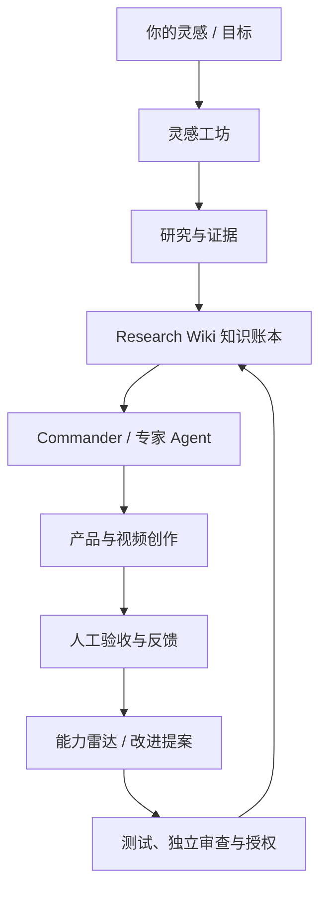

# Muse 用户手册与功能现状（B129）

更新：2026-11-13

> 本手册按当前桌面代码、Python API 路由和项目文档核对。状态只描述已观察到的实现，不把长期愿景写成已交付功能。

## 一、Muse 是什么

Muse 是本机优先的个人 Super Agent 工作台。Python 是业务核心，Tauri/Rust 是桌面宿主，Svelte 是操作界面。Muse Commander 负责统一调度；Agent、研究器、创作器和工具是可替换的执行能力。

这是一条产品目标流程。当前桌面只开放其中已接线的入口；并非每个箭头都已成为可点击的自动化操作。

## 二、当前桌面功能清单

| 模块 | 当前状态 | 现在能做什么 | 主要缺口 |
|---|---|---|---|
| 意识中枢 / 总览 | 已实现 | 本地连接、刷新时间、Agent/任务/事件摘要 | 缺少资源曲线与待审批快捷处理 |
| 灵感工坊 | 已实现 | 本地保存灵感；可显式允许进入联网研究候选池 | 尚无完整研究编辑器与来源核验工作台 |
| 研究与知识 | 后端已实现、UI 部分开放 | 研究记录/报告、Research Wiki；创作时间线可打开关联知识节点 | 缺少完整知识图谱浏览、反证对照与来源质量面板 |
| 视频创作 | 部分实现 | Wan 2.1 / ComfyUI 文生视频入口；FFmpeg 本地素材合成入口 | Wan 生成依赖本机服务/模型；预览级结果不等于完整长片 |
| 成果产品库 | 已实现 | 预览、下载 MP4、下载工程 ZIP、创作时间线、审片反馈 | 尚缺更完整的版本比较与发布管理 |
| 智能体舰队 | 已实现（只读监控） | Agent 身份、角色、能力声明、心跳、真实效果样本 | 桌面尚不能直接注册/启停/命令 Agent |
| 任务队列 / Commander | 已实现（只读监控） | 队列计数、活跃任务、Worker 心跳、可见的工作流阶段 | 桌面尚无批准、取消、重试、恢复操作 |
| 进化实验室 | 已实现（受控写入） | 结构化反馈、运行能力雷达、查看提案详情/来源/验收标准/回滚方案 | 桌面尚无提案批准/执行/回滚操作 |
| 星轨事件 | 已实现 | 有界事件流、近期事件列表 | 不是完整审计日志浏览器 |
| User / Agent 记忆 | 后端/CLI 已实现，桌面 UI 缺失 | 本地记忆存储、检索、修订历史、双轨区分 | 桌面尚无记忆管理页面 |
| 提醒 / Routine / Watchdog | 后端/CLI 与本机运行时已实现，桌面控制缺失 | 本机提醒、定时 routine、健康检查/恢复机制 | 尚缺桌面配置与完整状态控制面板 |
| 工具 / Provider / 资源 | 后端能力存在，桌面 UI 不完整 | 本地模型/Provider/工具适配与资源感知调度 | 缺少统一连接、配额、权限和资源诊断页 |
| 设置 / 安装 / 托盘 | 未完整交付 | 目前有桌面启动脚本与快捷方式 | 安装包、托盘、更新/回滚、完整设置页待做 |

## 三、从哪里开始使用

### 1. 打开 Muse

- 在 Windows 桌面双击 Muse 快捷方式，或运行项目中的 `scripts/Muse-Desktop.ps1` 构建并启动桌面版本。
- 主电脑本机使用时，优先使用桌面快捷方式提供的本机入口。
- 顶部显示「本地核心 · 在线」才代表本地 API 当前可连接；「数据已过期」表示界面保留了上次成功读取的数据，不是实时状态。

### 2. 提交第一条灵感

1. 打开「灵感工坊」。
2. 在输入框写一个目标，例如：「研究怎样把多智能体研究结果沉淀成可验证的知识图谱」。
3. 默认不勾选联网研究，点击「保存灵感并交给 Muse」。
4. 灵感会进入历史列表。若你希望使用公开资料研究，才勾选「允许 Muse 使用这段灵感进行联网研究」后保存。
5. 到「已交付研究报告」查看并下载已生成的 Markdown 报告。

**注意：** 保存成功不是研究已完成；允许联网研究也不保证搜索 Provider、网络和本机模型一定可用。检查灵感状态和报告列表确认结果。

### 3. 制作视频

**A. AI 灵感生成（Wan 2.1）**

1. 在「一键视频创作」选择「AI 灵感生成短片（Wan 2.1）」。
2. 输入影片名称与画面描述，可选填写负面提示词。
3. 选择横屏 16:9、竖屏 9:16 或正方形 1:1，并选择 1–5 秒预览时长。
4. 确认引擎状态显示 ComfyUI 就绪，再点击「一键 AI 生成 MP4」。
5. 查看任务状态；成功后到成果库预览并下载 MP4 / ZIP。

如果 ComfyUI 未就绪，先启动本机 ComfyUI 并确认 Wan 2.1 工作流/模型已正确加载。不要重复提交仍在运行或已中断的任务。当前桌面不会把重启后失去 Worker 的任务伪装成持续生成。

**B. 本地素材剪辑（FFmpeg）**

1. 把图片/视频素材复制到 `data/video_sources/你的文件夹名`。
2. 选择「本地素材剪辑合成（FFmpeg）」。
3. 填写影片名称、素材文件夹名；可选填写音轨文件名。
4. 选择背景音乐循环铺底或旁白按原时长处理。
5. 点击「一键制作 MP4」，完成后在成果库查看。

支持格式和限制以当前 UI 提示为准；请保留原始素材，Muse 不会覆盖源文件。

### 4. 查看与验收作品

- 「成果产品库」的「预览」用于查看产物。
- 「下载 MP4」取得视频文件。
- 「下载工程 ZIP」保存作品包与说明。
- 「创作时间线」查看创建、失败、审片和知识关联记录。
- 如果作品支持 Creator Initiative 反馈，写下具体镜头/节奏/声音问题，选择「需要修改」「拒绝本版」或「验收通过」，再提交审片意见。

### 5. 查看 Agent 与任务

- 「天枢 · 智能体阵列」看已登记 Agent 是否在线、执行中或离线，以及最近心跳。
- 「任务队列」看排队、运行、待审批、失败数量，以及当前可见的 Commander 流程和 Worker 状态。
- 当前这两块主要是监控面板。不要寻找尚未开放的批准/取消/重试按钮；桌面写操作必须等后端权限与审计流程接通后再开放。

### 6. 让 Muse 从反馈中改进

1. 在「反馈 · 自我改进」选择类别、问题标签与严重程度。
2. 点击「记录反馈」。
3. 点击「扫描改进机会」运行本机能力雷达。
4. 打开提案，检查问题、假设、证据来源、验收标准和回滚方案。

扫描只会产生/更新提案，不会自动修改代码。提案必须经过来源许可与安全审查、人工批准、执行、测试和独立 Reviewer。

### 7. 使用局域网共享

只有在你明确需要手机/平板访问时才使用共享入口。设备必须处于同一可信私有 Wi-Fi，首次访问输入 Muse 显示的配对码；配对有时效，Muse 重启后配对码会轮换。当前局域网 HTTP 未加密，不要在公共 Wi-Fi 或互联网端口转发环境使用。

## 四、常见问题

- **显示未连接：** 检查 Muse 本机后端/桌面进程是否运行，再点击刷新；若 API 子进程重启，客户端会尝试重新取得本机连接信息。
- **显示数据已过期：** 画面是上次成功快照，不是实时数据。恢复本机 API 后刷新。
- **AI 视频按钮不可用：** 先检查 ComfyUI 状态与 Wan 模型是否就绪；FFmpeg 素材剪辑与 AI 文生视频是两条不同路径。
- **任务重启后不再生成：** 持久化任务记录仍可找回，但没有活动 Worker 就不会自动假装继续运行。检查失败记录后再决定是否重新提交。
- **提案没有自动执行：** 这是安全设计。提案、批准、执行、测试和发布是不同阶段。
- **想在 ChatGPT 关闭后继续工作：** 这依赖你本机已启动并配置好的 Muse Runtime / Routine / Task Scheduler；ChatGPT 不会在对话结束后替本机持续运行。

## 五、当前安全边界

- 默认本机优先；灵感联网研究必须由用户显式勾选。
- 桌面 API 使用 loopback / 临时 Bearer 会话与 Origin 校验；UI 不直接访问 SQLite。
- Agent 能力声明不是执行权限。
- 玄学视角只生成灵感假设，不是事实证据。
- 提案不自动批准；代码修改须有测试、独立审查、回滚与授权。
- 不把构建成功等同于完整实机验收。

## 六、下一阶段逐项交付顺序

1. 真实桌面窗口截图与逐屏点击验收。
2. 任务中心：只在后端授权、审计与状态机齐备后开放批准/取消/重试/恢复。
3. 研究与知识图谱：节点/关系/支持与反证/来源质量/假设状态统一呈现。
4. User / Agent 双轨记忆管理页与修订历史。
5. Routine、提醒、Watchdog 的运行状态与暂停/恢复界面。
6. Agent 管理、工具/Provider/资源诊断页。
7. 安装包、托盘、通知、升级/回滚和设置页。

